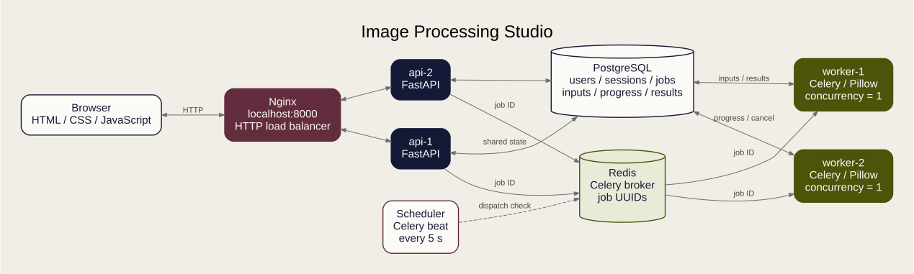
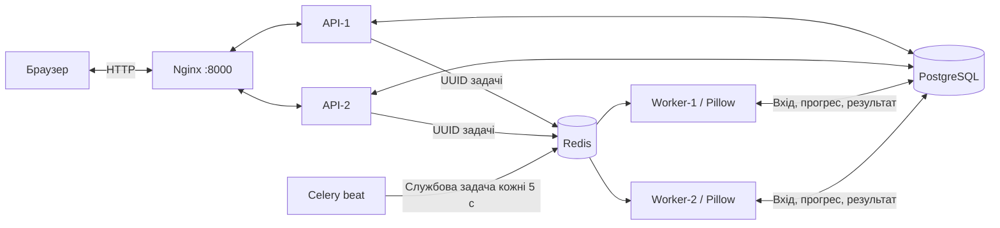
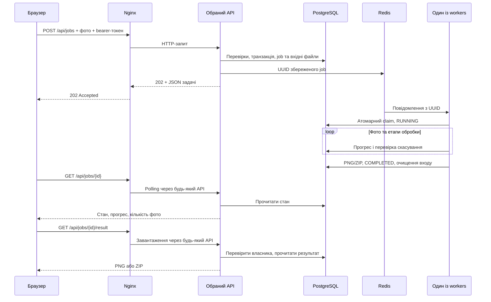
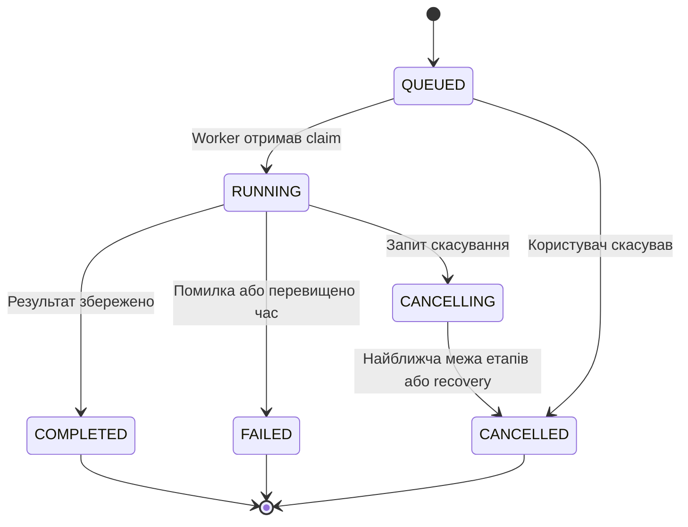

# Архітектура Image Processing Studio

Схема для слайдів: [SVG](assets/architecture.svg) · [PNG](assets/architecture.png).
Редагований вихідний файл: [Graphviz DOT](assets/architecture.dot).

## Компоненти

| Компонент | Що робить | Де налаштовано |
|---|---|---|
| Браузер | HTML/CSS/JavaScript, вибір фото, polling, завантаження | [frontend](../frontend) |
| Nginx | Єдиний вхід `localhost:8000`, балансування HTTP між API | [nginx/default.conf](../nginx/default.conf) |
| `api-1`, `api-2` | Реєстрація, сесії, перевірка файлів, створення й перегляд задач | [main.py](../backend/app/main.py), [jobs.py](../backend/app/jobs.py) |
| PostgreSQL | Користувачі, хеші сесій, задачі, прогрес, вхідні фото, результати, ліміти входу | [database.py](../backend/app/database.py) |
| Redis | Брокер повідомлень Celery; передає UUID задач | [queue.py](../backend/app/queue.py) |
| `worker-1`, `worker-2` | Окремі процеси Celery/Pillow; один job на worker одночасно | [tasks.py](../backend/app/tasks.py), [image_service.py](../backend/app/image_service.py) |
| Scheduler | Celery beat ставить службову перевірку в чергу кожні 5 с | [queue.py](../backend/app/queue.py) |
| Docker Compose | Запускає 8 сервісів, мережу й постійні томи PostgreSQL/Redis | [compose.yaml](../compose.yaml) |

## Схема у Mermaid

Обидва API та workers мають доступ до однієї PostgreSQL. Файли зараз зберігаються
в її `BYTEA`/`BYTEA[]`; результат доступний через будь-який API. Окремого файлового
сховища в поточній версії немає. Redis не містить фото або готових PNG/ZIP.

## Шлях одного пакета

1. Браузер надсилає 1–10 фото й спільну рамку через Nginx.
2. Один API перевіряє сесію, файли, кількість, байти, пікселі та ліміти задач.
3. У транзакції створюються job і вхідні дані в PostgreSQL. API намагається
   передати UUID у Redis й повертає **202 Accepted** із job ID.
4. Один worker атомарно змінює `QUEUED` на `RUNNING`. Повторне повідомлення
   не дозволяє другому worker повторно виконати цей job.
5. Worker послідовно змінює розмір фото, оновлює stage/progress/processed_files
   і перевіряє запит скасування між етапами та зображеннями.
6. Для одного фото зберігається PNG, для кількох — ZIP із PNG. Вхідні байти
   видаляються при термінальному стані задачі.
7. Браузер опитує стан кожні 1,5 с. Запити можуть потрапляти до різних API,
   які читають ту саму БД. Результат завантажується окремим HTTP-запитом.

## Два різні види розподілу

| Рівень | Хто розподіляє | Що розподіляється | Доказ |
|---|---|---|---|
| HTTP | Nginx upstream | Окремі HTTP-запити | `instance_id`, `X-Instance-ID`, Nginx upstream log |
| Обчислення | Брокер Redis і споживачі Celery | Окремі jobs | `job.id` і `worker_id` у метаданих |

Один пакет виконує один worker, фото всередині нього обробляються послідовно.
Два workers можуть одночасно виконувати два різні пакети. Nginx не розподіляє
пікселі або окремі фото всередині job.

## Стани

Прогрес умовний, за етапами; це не точний відсоток оброблених пікселів. Межі часу
Celery — 50 с soft і 60 с hard на весь пакет. Періодична службова задача, яку
виконує доступний worker, позначає активні jobs віком понад 90 с невдалими або
скасованими. За відсутності workers ця перевірка теж чекатиме в черзі.

Збережений `QUEUED` job також є durable outbox: якщо перша публікація в Redis
не вдалася, службова перевірка повторить її. Це не означає автоматичний повтор
обчислення вже початого job: після аварії такий job може завершитися `FAILED`.

## Межі поточної архітектури

Nginx, PostgreSQL і Redis запущені по одному. Перевірена робота при зупинці одного
API не означає повну відмовостійкість усієї системи. HTTPS, autoscaling, ETA,
admin-монітор і автоматичне очищення старих результатів ще не реалізовані.
